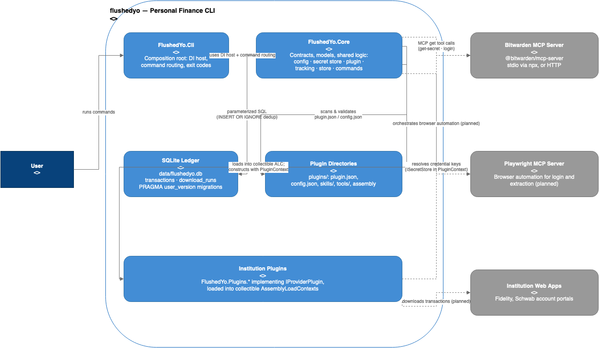

# flushedyo

**flushedyo** is a personal-finance CLI that downloads your transactions from multiple financial institutions, deduplicates them into a local SQLite ledger, and resolves credentials safely through a swappable secret store — all extensible via plugins, with zero changes to core code when you add a new institution.

```
Usage:
  flushedyo get-secret <key> [--raw]              Resolve a secret from the configured secret store.
  flushedyo plugins list                          List discovered plugins.
  flushedyo login [--plugin <name>] [--json]      Check that each plugin's credentials exist in the secret store.
  flushedyo download [--plugin <name>] [--json]   Download transactions and store the new ones (deduplicated).
  flushedyo status [--plugin <name>] [--json]     Show each plugin's last download and stored totals.
```

---

## Why flushedyo?

The goal is a complete, trustworthy picture of your finances: download transactions and account state from every institution you use, keep them in one deduplicated ledger, and — over time — let local or API-based agents analyze that data to make recommendations and carry out tasks.

Three design principles make this safe and maintainable:

1. **Multi-institution extensibility.** Every institution (Fidelity, Schwab, …) is a self-contained plugin folder dropped into `plugins/`. Adding a bank never requires changing core code.
2. **Secret-store abstraction.** Credentials are resolved through an `ISecretStore` interface — Bitwarden (via the [Bitwarden MCP server](https://www.npmjs.com/package/@bitwarden/mcp-server)) today, environment variables for development. Secrets are never logged, printed (unless `--raw`), persisted, or committed.
3. **Idempotent downloads.** Every transaction gets a canonical SHA-256 hash computed from normalized fields, and an atomic `INSERT OR IGNORE` writes it to the ledger. Running `download` twice can never create duplicates — the same is true for partial or interrupted runs.

Plugins can also be *agentic*: they declare MCP-server dependencies (e.g. a Playwright browser-automation server), skills, and tools in their manifests, and the runtime orchestrates them — this is where browser-based logins and transaction scraping will come from (planned; see [Roadmap](#roadmap)).

### Current status

Core machinery is implemented and tested; real institution plugins are not yet shipped:

| Area | Status |
|---|---|
| CLI surface — `get-secret`, `plugins list`, `login`, `download`, `status` | ✅ Implemented |
| Secret stores — Bitwarden MCP (stdio/HTTP) + environment variables | ✅ Implemented |
| Plugin discovery, manifests, collectible assembly loading | ✅ Implemented |
| Dedup pipeline + SQLite ledger (migrations v1 and v2) | ✅ Implemented |
| Real institution plugins (`plugins/fidelity`, `plugins/schwab`) | 🔶 Planned |
| Playwright MCP orchestration, agentic skills/tools | 🔶 Planned |
| Analysis/recommendation agents | 🔶 Planned |
| MFA / TOTP handling, automated credential rotation | 🔶 Known gaps, deferred |

See [`docs/Architecture.md` §9][arch-status] for the detailed status table

---

## Requirements

| Dependency | Required? | Why | Install |
|---|---|---|---|
| [.NET SDK 10.x](https://dotnet.microsoft.com/download/dotnet/10.0) | ✅ Yes | Builds and runs the CLI. `global.json` pins `10.0.103` (rolling to the latest feature patch). | [Install .NET 10](https://dotnet.microsoft.com/en-us/download/dotnet/10.0) |
| [Node.js](https://nodejs.org/) (18+, includes `npx`) | Needed for the default secret store | `npx -y @bitwarden/mcp-server` launches the Bitwarden MCP server over stdio. | [Install Node.js](https://nodejs.org/en/download) |
| [Bitwarden CLI (`bw`)](https://bitwarden.com/help/cli/) | Needed for the default secret store | Unlocks your vault (`BW_SESSION`); the MCP server reads items through it. | [Install the `bw` CLI](https://bitwarden.com/help/cli/#download-and-install) |
| [Bitwarden MCP server](https://www.npmjs.com/package/@bitwarden/mcp-server) | Needed for the default secret store | No separate install — `npx -y @bitwarden/mcp-server` fetches it on first use (works over stdio; an HTTP endpoint is also supported via configuration). | [Package docs](https://www.npmjs.com/package/@bitwarden/mcp-server) |
| SQLite | ❌ Not required | The ledger uses [`Microsoft.Data.Sqlite`](https://learn.microsoft.com/dotnet/standard/data/sqlite/), which bundles its own engine — nothing to install. | — |
| [draw.io](https://github.com/jgraph/drawio) | Optional | Only for editing the C4 diagrams in `docs/c4/`. | [Project docs](https://github.com/jgraph/drawio) |

> **Avoiding Node.js/Bitwarden entirely:** set `FLUSHEDYO__SECRETSTORE__PROVIDER=EnvironmentVariables` (or edit `SecretStore:Provider` in `appsettings.json`) and provide secrets as `FLUSHEDYO_SECRET_<KEY>` environment variables instead — useful for development and CI.

---

## Getting started

### 1. Clone and build

```bash
git clone <your-fork-url> flushedyo
cd flushedyo
dotnet build flushedyo.slnx
```

### 2. Run the test suite

```bash
dotnet test --solution flushedyo.slnx
```

xUnit v3 + Microsoft.Testing.Platform. If you don't have a Bitwarden vault available, the Live category fails by design; you can exclude it:

```bash
dotnet test --solution flushedyo.slnx --filter "Category!=Live&Category!=Network"
```

### 3. Configure your secret store

**Option A — Bitwarden (default).** Unlock your vault and export the session key; the CLI passes `BW_SESSION` through to the MCP server:

```bash
export BW_SESSION=$(bw unlock --raw)
```

Test it with a Login item named `testconnection` that has a password:

```bash
dotnet run --project src/FlushedYo.Cli -- get-secret testconnection
# ********        (masked by default)
dotnet run --project src/FlushedYo.Cli -- get-secret testconnection --raw
```

**Option B — Environment variables.**

```bash
export FLUSHEDYO__SECRETSTORE__PROVIDER=EnvironmentVariables
export FLUSHEDYO_SECRET_FIDELITY_USERNAME=me@example.com
dotnet run --project src/FlushedYo.Cli -- get-secret fidelity/username
```

Env-var secret keys map `/` → `_` and uppercase: `fidelity/username` → `FLUSHEDYO_SECRET_FIDELITY_USERNAME`.

### 4. Try the commands

```bash
dotnet run --project src/FlushedYo.Cli -- plugins list
dotnet run --project src/FlushedYo.Cli -- login
dotnet run --project src/FlushedYo.Cli -- download
dotnet run --project src/FlushedYo.Cli -- status
```

The ledger (`data/flushedyo.db`) is created lazily on the first command that needs it — `get-secret` and `plugins list` never touch the disk. Table output goes to **stdout**; logs, warnings, and errors go to **stderr** (`--json` yields structured output instead).

### 5. Install as a .NET tool

flushedyo is packaged as a .NET tool (`PackageId` `FlushedYo`, command `flushedyo`). Install it from this checkout:

```bash
./scripts/install-tool.sh                    # pack + install globally
./scripts/install-tool.sh --tool-path ~/bin  # pack + install into a directory
./scripts/install-tool.sh --pack-only        # just produce dist/FlushedYo.<version>.nupkg
```

Then run it from anywhere:

```bash
flushedyo plugins list
```

Or drive the same three `dotnet` commands by hand:

```bash
dotnet pack src/FlushedYo.Cli -c Release -o ./dist
dotnet tool install --global FlushedYo --add-source ./dist --version 1.0.0
flushedyo plugins list
```

If `flushedyo` is not found after a global install, add `$HOME/.dotnet/tools` to `PATH` (`export PATH="$HOME/.dotnet/tools:$PATH"`). Upgrading means re-running the script, which uninstalls the previous version first; `dotnet tool uninstall --global FlushedYo` removes it.

> **Point the tool at real data directories.** A relative `PluginDirectory` / `LedgerPath` resolves against the nearest ancestor of the *current* directory containing `flushedyo.slnx`, so a globally installed tool run outside a checkout falls back to the current directory. Set absolute paths once:
>
> ```bash
> export FLUSHEDYO__PLUGINDIRECTORY="$HOME/.flushedyo/plugins"
> export FLUSHEDYO__LEDGERPATH="$HOME/.flushedyo/data/flushedyo.db"
> ```

Publishing to a feed instead of a local package is the same metadata, published: `dotnet nuget push dist/FlushedYo.1.0.0.nupkg --api-key <key> --source https://api.nuget.org/v3/index.json`, after which `dotnet tool install --global FlushedYo` needs no `--add-source`.

A framework-dependent `dotnet publish` is also still available if you want a loose binary:

```bash
dotnet publish src/FlushedYo.Cli -c Release -o ./publish
./publish/FlushedYo.Cli plugins list
```

---

## Configuration

Configuration comes from `src/FlushedYo.Cli/appsettings.json` (the `FlushedYo` section) and can be overridden by environment variables using the standard `__` delimiter with no prefix.

| Setting | Default | Env override | Notes |
|---|---|---|---|
| `SecretStore:Provider` | `BitwardenMcp` | `FLUSHEDYO__SECRETSTORE__PROVIDER` | `BitwardenMcp` or `EnvironmentVariables` (case-insensitive) |
| `SecretStore:BitwardenMcp:Command` | `npx` | `FLUSHEDYO__SECRETSTORE__BITWARDENMCP__COMMAND` | stdio transport: executable that launches the MCP server |
| `SecretStore:BitwardenMcp:Arguments` | `-y @bitwarden/mcp-server` | `FLUSHEDYO__SECRETSTORE__BITWARDENMCP__<N>` | Use `appsettings.json` to change list values |
| `SecretStore:BitwardenMcp:Url` | — | `…__URL` | HTTP transport to an already-running server; takes precedence over `Command` |
| `SecretStore:BitwardenMcp:ConnectTimeoutSeconds` | `30` | `…__CONNECTTIMEOUTSECONDS` | First `npx -y` run may need more (it downloads the package) |
| `SecretStore:BitwardenMcp:CallTimeoutSeconds` | `30` | `…__CALLTIMEOUTSECONDS` | Per tool call |
| `PluginDirectory` | `plugins` | `FLUSHEDYO__PLUGINDIRECTORY` | Relative paths resolve against the repository root; absolute paths are used as-is |
| `LedgerPath` | `data/flushedyo.db` | `FLUSHEDYO__LEDGERPATH` | Same relative-path rule |

**Exit codes:** `0` success · `1` usage error, unknown plugin, or missing credentials · `2` command failures (secret store, plugin, ledger) · `130` Ctrl+C cancellation.

---

## Architecture

The full architecture — C4 system context, containers, components, and the `download` flow sequence — lives in **[docs/Architecture.md](docs/Architecture.md)**, written in the [C4 model](https://c4model.com/) style with editable `.drawio` sources in [`docs/c4/`](docs/c4/). Highlights:



| Container | What it does |
|---|---|
| **FlushedYo.Cli** (`src/FlushedYo.Cli/`) | Thin composition root: DI host, config binding, argument routing, exit codes, stdout/stderr contract. |
| **FlushedYo.Core** (`src/FlushedYo.Core/`) | All contracts and shared logic: `ISecretStore`, plugin machinery, dedup tracking, transaction/run-history stores, commands and formatters. Split into `Configuration/`, `SecretStore/`, `Plugin/`, `Tracking/`, `Store/`, `Models/`, `Commands/`. |
| **SQLite ledger** (`data/flushedyo.db`) | Deduplicated `transactions` (unique `canonical_hash`) + per-plugin `download_runs` audit history. Lazy open; schema migrations tracked by `PRAGMA user_version`. |
| **Plugin directories** (`plugins/<institution>/`) | `plugin.json` + optional `config.json`, `skills/`, `tools/`, and an optional plugin `.dll` loaded into a collectible `AssemblyLoadContext`. |
| **Bitwarden MCP server** (external) | Resolves credentials via MCP `get`, launched with `npx -y` or reached over HTTP. |

Key decisions worth knowing before you contribute:

- **The dedup hash is a permanent contract.** `CanonicalTransactionHasher` (`FlushedYo.Core.Tracking`) computes `SHA-256("{institution}|{externalId}|{amount}|{date}|{payee}")` over normalized fields, with pinned known-answer tests. Changing any rule requires a ledger migration, because stored hashes must keep matching. `type` is deliberately not hashed.
- **The plugin loader is surgical.** Discovery reads JSON and checks files exist — it never touches secrets, starts MCP servers, or loads assemblies. Executable plugins (`assembly` + `type` in the manifest) are loaded into collectible ALCs where `FlushedYo.Core` types resolve from the host, and unloaded after use. Invalid plugins warn on stderr and are skipped; they never fail a command.
- **All SQL is parameterized.** Schema changes are ordered entries in `LedgerMigrations.All`; never edit an applied migration.
- **Value-free logging.** Logs contain counts, batch indexes, and exception type names only — never payees, amounts, IDs, hashes, or secrets.

See [docs/Architecture.md §7][arch-extensibility] for the full extensibility walkthrough and [§6][arch-dedup] for the complete dedup and migration policy.

---

## Project layout

```
flushedyo/
├── flushedyo.slnx               # Solution — add projects here
├── global.json                  # Pins the .NET 10 SDK + test runner
├── Directory.Build.props        # Warnings-as-errors, nullable, etc.
├── Directory.Packages.props     # Central package version management (CPM)
├── docs/
│   ├── Architecture.md          # Full architecture documentation (README links here)
│   └── c4/                      # C4 diagrams (.drawio sources + .png exports)
├── specs/                       # Feature specs (board + numbered specs)
├── src/
│   ├── FlushedYo.Cli/           # Entry point: Program.cs (DI + routing), appsettings.json — packs as the `flushedyo` tool
│   └── FlushedYo.Core/          # Configuration, SecretStore, Plugin, Tracking, Store, Models, Commands
├── scripts/                     # bw-unlock.sh, generate-coverage.sh, install-tool.sh
├── tests/
│   ├── FlushedYo.Core.Tests/            # Unit tests (xUnit v3)
│   ├── FlushedYo.Core.PropertyTests/    # FsCheck property tests
│   ├── FlushedYo.ArchitectureTests/     # ArchUnitNET rules
│   ├── FlushedYo.IntegrationTests/      # CLI end-to-end (child processes), Live/Network categories
│   ├── FlushedYo.Tests.FakeMcpServer/   # In-memory fake MCP server for tests
│   └── FlushedYo.Tests.StubPlugin/      # Stub plugin fixture for integration tests
├── plugins/                     # Deployed plugin folders (created per institution)
└── data/                        # SQLite ledger (generated on first use; gitignored)
```

---

## Writing a plugin: the quick tour

Adding an institution means creating one folder — no core changes:

```
plugins/fidelity/
├── plugin.json      # name, version, capabilities, mcpServers, skills, tools, (assembly, type)
├── config.json      # MCP endpoints, headless flag, credential key names
├── skills/          # e.g. login.md, navigate-accounts.md, extract-transactions.md
├── tools/           # e.g. click.md, type.md, extract-table.md
└── FlushedYo.Plugins.Fidelity.dll   # optional executable plugin
```

Rules that keep this safe:

- Plugin names are lowercase `^[a-z0-9][a-z0-9-]*$`; the folder name must match the manifest name (case-insensitively).
- Capabilities (`download-transactions`, `download-holdings`) gate what `download` attempts.
- Executable plugins declare `assembly` + `type` and implement `IProviderPlugin`, constructed with a `PluginContext` (descriptor, `ISecretStore`, logger). The assembly must live inside the plugin folder, and the constructed plugin's name/version must match the manifest.
- Declare MCP-server needs (`mcpServers: ["bitwarden", "playwright", …]`) rather than wiring hard dependencies — the runtime orchestrates them (Playwright orchestration is planned).

See [docs/Architecture.md §7][arch-extensibility] for the full extensibility walkthrough, including how the test fixture plugin (`tests/FlushedYo.IntegrationTests/Fixtures/plugins/dummy/`) exercises every rule.

---

## Development

```bash
dotnet build flushedyo.slnx                        # Build — expect 0 warnings (warnings are errors)
dotnet test --solution flushedyo.slnx              # All tests
dotnet test --project tests/FlushedYo.Core.Tests   # Unit tests only
dotnet test --project tests/FlushedYo.IntegrationTests \
    --filter "Category!=Live&Category!=Network"    # Integration tests (no vault needed)
dotnet format flushedyo.slnx --verify-no-changes   # Format check
```

CI-equivalent bar without a vault: clean build + unit tests + filtered integration tests + format check.

Notes for contributors:

- xUnit **v3** on Microsoft.Testing.Platform — `dotnet test` needs `--project`/`--solution` (a bare positional path fails), and test projects are executables referencing only `xunit.v3`.
- Package versions are managed centrally in [`Directory.Packages.props`](Directory.Packages.props); keep `Microsoft.Extensions.*` and `ModelContextProtocol` aligned across projects when adding a project.
- Tests mirror Core's folder structure one-to-one, use temp SQLite files (never `:memory:`), and restore environment variables in `finally` blocks. Reuse the shared helpers (`TempPluginDirectory`, `TempLedger`, `CapturingLogger<T>`, …) rather than duplicating them.
- Plugins and MCP specifics are covered in [`AGENTS.md`](AGENTS.md), which doubles as a conventions/known-gotchas reference.
- The C4 diagrams are regenerated from `docs/c4/*.drawio`; see [docs/Architecture.md §10][arch-diagrams] for the draw.io export commands.

---

## License

flushedyo is licensed under the [MIT License](LICENSE). Third-party dependencies remain under their own licenses — see their respective NuGet/npm pages for details.

---

[arch-status]: docs/Architecture.md#9-implementation-status
[arch-extensibility]: docs/Architecture.md#7-extensibility-model
[arch-dedup]: docs/Architecture.md#6-data-model-and-the-dedup-contract
[arch-diagrams]: docs/Architecture.md#10-diagram-regeneration-drawio
