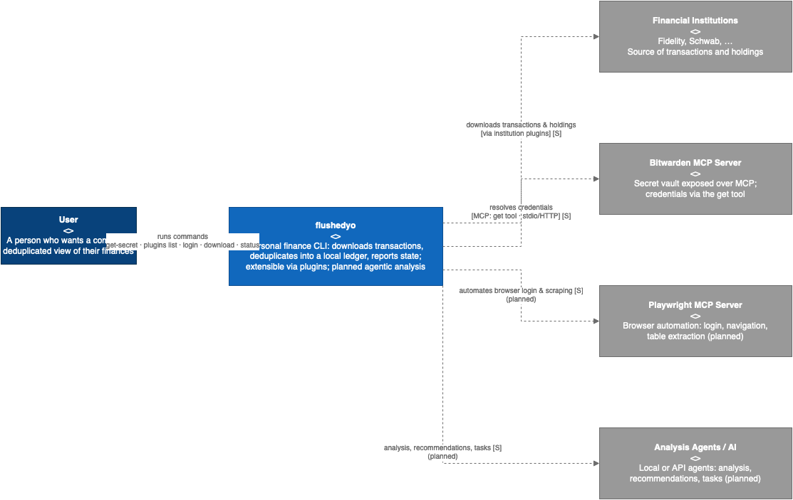
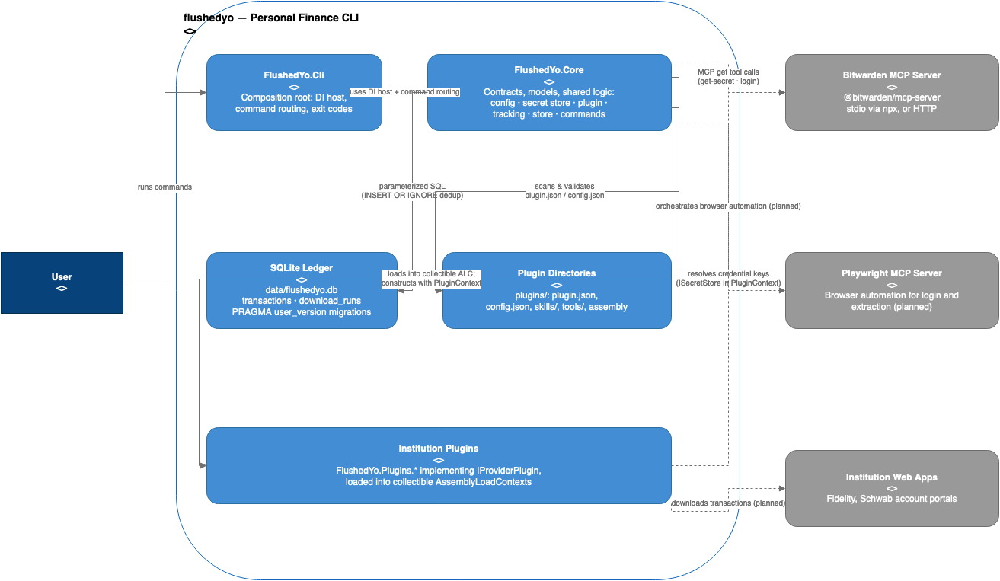
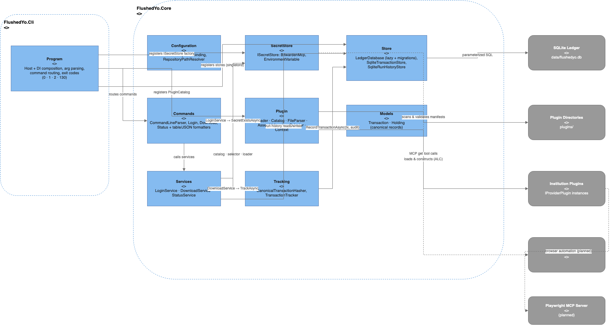
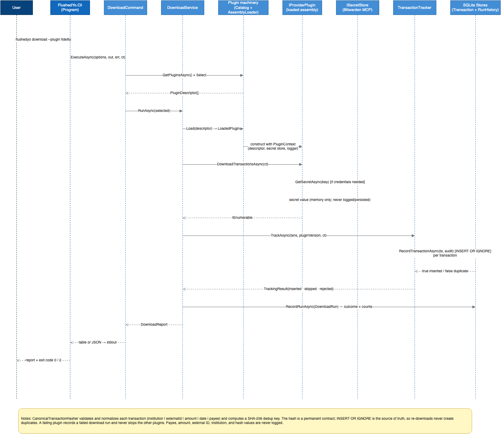

# flushedyo — Architecture

> **Document type:** Architecture description using the [C4 model](https://c4model.com/) (Levels 1–3 plus a dynamic diagram).
> **Scope:** Target-state architecture. flushedyo is under active development; sections marked *(planned)* describe Phases 5–7
> of [`plan.md`](../plan.md) and the agentic capabilities in plan §0, which are not yet implemented.
> **Status basis:** Derived from code inspection and `plan.md` on **2026-10-28**.
> Note: `plan.md` phase checkboxes lag the code — Phases 1–4 are substantially implemented (see [§9](#9-implementation-status)).

| Diagram | Source | Preview |
|---|---|---|
| C4 Level 1 — System Context | [`c4/system-context.drawio`](c4/system-context.drawio) |  |
| C4 Level 2 — Containers | [`c4/containers.drawio`](c4/containers.drawio) |  |
| C4 Level 3 — Components | [`c4/components.drawio`](c4/components.drawio) |  |
| Dynamic — `download` flow | [`c4/download-sequence.drawio`](c4/download-sequence.drawio) |  |

Diagrams are stored as editable draw.io sources in `docs/c4/*.drawio` and exported as images next to them. See [§10](#10-diagram-regeneration-drawio).

---

## 1. Intent

### 1.1 Purpose

flushedyo is a personal-finance CLI that:

1. **Downloads** financial transactions and account state from multiple institutions (Fidelity, Schwab, …) through a **plugin system**, so adding an institution never requires changing core code.
2. **Deduplicates** downloads into a **local SQLite ledger**, so re-downloading the same transaction never creates a duplicate.
3. **Resolves credentials** through a swappable **secret-store abstraction** (Bitwarden MCP today, environment variables for development; other stores must be addable without touching plugin code).
4. **(Planned)** Enables **agents** — local or API-based — to analyze the accumulated data, make recommendations, and carry out tasks. Plugins may be *agentic*: they declare MCP-server dependencies, skills, and tools (e.g., a Playwright-based login skill) that the runtime will orchestrate.

### 1.2 Design goals (mapped to `plan.md` concerns)

| # | Goal | Mechanism |
|---|---|---|
| A | Multi-institution extensibility | Directory-scanned plugins (`plugins/<institution>/`), JSON manifests, no core changes to add an institution |
| B | Secret-store abstraction | `ISecretStore` interface; `BitwardenMcpSecretStore` (MCP stdio/HTTP) and `EnvironmentVariableSecretStore`; provider selected by config |
| C | Idempotent download | Canonical SHA-256 dedup key per transaction; atomic `INSERT OR IGNORE` in the ledger; hash is a **permanent contract** |
| D | Agentic plugin support | Plugins declare `mcpServers`, `skills`, `tools`, `capabilities`; runtime will orchestrate MCP servers and tools (planned) |
| E | Known gaps | MFA/TOTP, credential rotation, security-lot tracking are deferred (plan §8) |

### 1.3 Non-goals (currently)

- Time-based MFA / interactive two-factor resolution.
- Automated credential rotation (secrets are read on demand).
- Security-lot-level investment tracking (holdings are deliberately minimal).
- Multi-user/multi-process ledger use (single-user tool; concurrent first-open migration is a documented, accepted race).

---

## 2. C4 Level 1 — System Context


### Elements

| Element | Type | Description |
|---|---|---|
| **User** | Person | Financial account owner who runs the CLI to gather a complete, deduplicated view of their finances. |
| **flushedyo** | Software system | Personal finance CLI: downloads transactions, deduplicates into a local ledger, reports state; extensible via plugins; planned agentic analysis. |
| **Financial Institutions** | External system | Fidelity, Schwab, etc. Source of transaction and holding data via web sessions. |
| **Bitwarden MCP Server** | External system | Secret vault exposed over MCP (`@bitwarden/mcp-server`); resolves credentials via its `get` tool. |
| **Playwright MCP Server** *(planned)* | External system | Browser automation (login, navigation, table extraction) that agentic plugins will drive. |
| **Analysis Agents / AI** *(planned)* | External system | Local or API-based agents that analyze data, make recommendations, and carry out tasks (plan §0). |

### Relationships

| From | To | Description |
|---|---|---|
| User | flushedyo | Runs `get-secret`, `plugins list`, `login`, `download`, `status` |
| flushedyo | Financial Institutions | Downloads transactions and holdings via institution plugins `[S]` |
| flushedyo | Bitwarden MCP Server | Resolves credentials via the MCP `get` tool (stdio via `npx`, or HTTP) `[S]` |
| flushedyo | Playwright MCP Server | Automates browser login and scraping `[S]` *(planned)* |
| flushedyo | Analysis Agents | Performs analysis, recommendations, tasks `[S]` *(planned)* |

---

## 3. C4 Level 2 — Containers


The software system contains four containers plus the plugin packages it loads:

| Container | Type | Description |
|---|---|---|
| **FlushedYo.Cli** | Console application (`.NET 10`) | Thin composition root: builds the DI host, binds `FlushedYoOptions` from `appsettings.json` + `FLUSHEDYO__…` env overrides, parses arguments, routes commands, maps exit codes, owns stdout/stderr. |
| **FlushedYo.Core** | Class library | All contracts, models, and shared logic: configuration, secret store, plugin machinery, tracking (dedup), stores, commands/services, output formatters. |
| **SQLite Ledger** | Database (`data/flushedyo.db`) | Deduplicated transaction rows + per-plugin download-run history. Opened lazily; schema migrations via `PRAGMA user_version`. |
| **Plugin Directories** | File system (`plugins/<institution>/`) | Deployed plugin packages: `plugin.json`, optional `config.json`, `skills/`, `tools/`, optional plugin `.dll`. |
| **Institution Plugins** | Dynamically loaded assemblies (`FlushedYo.Plugins.*`) | `IProviderPlugin` implementations loaded at runtime into **collectible `AssemblyLoadContext`s**; constructed with a `PluginContext` (descriptor, secret store, logger). |

External containers: **Bitwarden MCP Server** (process), **Playwright MCP Server** (process, planned), **Institution Web Apps** (Fidelity/Schwab portals).

### Key design properties

- **Lazy ledger:** `LedgerDatabase` touches disk only on first `OpenAsync`; `get-secret` and `plugins list` never create `data/`.
- **Plugin isolation:** each plugin loads into its own collectible ALC; `FlushedYo.Core` and `Microsoft.Extensions.*` resolve from the host so interfaces have a single identity; plugin assemblies are unloaded after use.
- **Extensibility invariant:** discovery reads JSON and checks file existence only — it never calls `ISecretStore`, starts MCP servers, or instantiates plugin code; invalid plugins warn and are skipped.
- **stdout/stderr contract:** stdout is reserved for command output; logs and errors go to stderr.

---

## 4. C4 Level 3 — Components


This diagram looks inside the two application containers; other flushedyo containers (ledger, plugin directories, plugin assemblies) and external processes are shown as external for focus.

### FlushedYo.Cli

| Component | Responsibility |
|---|---|
| **Program** | `Host.CreateApplicationBuilder` rooted at `AppContext.BaseDirectory`; DI registrations; argument dispatch; Ctrl+C cancellation; exit-code mapping (`0` ok, `1` usage/unknown/missing credentials, `2` failures, `130` cancelled). |

### FlushedYo.Core

| Component | Responsibility | Key types |
|---|---|---|
| **Configuration** | Binds the `FlushedYo` section; resolves repo-relative paths (plugin dir, ledger) against the nearest ancestor containing `flushedyo.slnx`. | `FlushedYoOptions`, `RepositoryPathResolver`, `PluginDirectoryResolver` |
| **SecretStore** | `ISecretStore` contract + implementations; Bitwarden via MCP client (stdio `npx -y @bitwarden/mcp-server` or HTTP; preflight `status` check; connect/call timeouts). | `ISecretStore`, `BitwardenMcpSecretStore`, `EnvironmentVariableSecretStore` |
| **Plugin** | Manifest/config parsing + validation; directory scan; cached catalog; collectible-ALC assembly loading; capability mapping; `--plugin` selection. | `PluginFileParser`, `PluginLoader`, `PluginCatalog`, `IPluginAssemblyLoader`, `PluginAssemblyLoader`, `PluginLoadContext`, `PluginSelector`, `PluginContext` |
| **Commands** | Shared flag parsing (`--plugin`, `--json`) and the three command handlers + table/JSON formatters. | `CommandLineParser`, `LoginCommand`, `DownloadCommand`, `StatusCommand`, formatters |
| **Services** | Orchestrates each command's work. | `LoginService`, `DownloadService`, `StatusService` |
| **Tracking** | Validates/normalizes transactions and computes the canonical SHA-256 dedup key; feeds the store idempotently. | `CanonicalTransactionHasher`, `TransactionTracker`, `TrackingResult` |
| **Store** | Lazy ledger open + migrations; transaction inserts (atomic `INSERT OR IGNORE`); run-history reads/writes; audit records. | `LedgerDatabase`, `LedgerMigrations`, `SqliteTransactionStore`, `SqliteRunHistoryStore`, `TransactionAudit`, `DownloadRun` |
| **Models** | Canonical records plugins produce. | `Transaction`, `Holding` |

### Component relationships (highlights)

```
Program ──routes──▶ Commands ──calls──▶ Services
Program ──selects──▶ SecretStore          │
Commands ──▶ Plugin (catalog/selector)    ├──▶ Tracking ──▶ Store ──▶ SQLite Ledger
Services ──▶ SecretStore (login preflight)│                │
Services ──▶ Plugin (assembly loader)     └──▶ Store (run history)
Plugin ──▶ Plugin directories / Plugin assemblies
SecretStore ──▶ Bitwarden MCP server (MCP get tool)
```

---

## 5. Key flows

### 5.1 `flushedyo download` (dynamic diagram)


1. `Program` routes `download [--plugin <name>] [--json]` to `DownloadCommand`.
2. `DownloadCommand` asks `IPluginCatalog` for installed plugins (cached after first scan) and applies `PluginSelector`.
3. `DownloadService.RunAsync` processes each selected plugin **one at a time**; a failing plugin never stops the others.
4. For each plugin: `PluginAssemblyLoader.Load(descriptor)` loads the assembly into a collectible ALC and constructs the `IProviderPlugin` with a `PluginContext` (verifying name/version against the manifest).
5. `DownloadTransactionsAsync(ct)` runs. Plugins may resolve credentials through `ISecretStore` (Bitwarden `get` tool); *(planned)* agentic plugins will drive a Playwright MCP server for login/navigation.
6. Returned transactions are materialized **before** the plugin's load context is released; transactions whose `Institution` doesn't match the plugin name are rejected.
7. `TransactionTracker.TrackAsync` per transaction: validate → canonicalize → SHA-256 → `RecordTransactionAsync` with a `TransactionAudit` (hash, plugin version, download time). The store performs `INSERT OR IGNORE`; the insert result is the source of truth (no check-then-insert race).
8. One `DownloadRun` row is recorded per attempted plugin (outcome, counts, value-free error).
9. `DownloadCommand` prints a table or JSON to **stdout** and returns exit code `0` (no failures) or `2` (any failure).

### 5.2 Other commands

- **`login`** — `LoginService` asks only whether each plugin's configured credential keys exist (`SecretExistsAsync`); never keeps or logs values; persists nothing.
- **`status`** — `StatusService` reads the latest run per plugin and stored transaction counts (ledger untouched when it doesn't exist); can report institutions with data but no installed plugin.
- **`get-secret <key> [--raw]`** — direct `ISecretStore` read; masked unless `--raw`; never touches the ledger.
- **`plugins list`** — `PluginTableFormatter` over the catalog; pure discovery, no secrets/MCP/assembly loading.

### 5.3 Planned: agentic flows (plan §0, Phases 5–6)

Institution plugins will declare `mcpServers` (bitwarden, playwright) and `skills`/`tools` (login, navigate-accounts, extract-transactions, click, type, extract-table). The runtime will orchestrate the declared MCP servers so a plugin can log into a portal and scrape transactions, then feed the same dedup pipeline.

---

## 6. Data model and the dedup contract

### Ledger schema (`data/flushedyo.db`)

**`transactions`** (migration v1): `id`, `canonical_hash` (**UNIQUE**), `institution`, `external_id`, `amount`, `date`, `payee`, `type`, `plugin_version`, `downloaded_at`; index on `institution`.

**`download_runs`** (migration v2): `id`, `plugin`, `plugin_version`, `started_at`, `finished_at`, `outcome` (`succeeded`/`failed` CHECK), `inserted`, `skipped`, `rejected`, `error`; index on `(plugin, id)`.

### Canonical dedup key (permanent contract)

`SHA-256("{institution}|{externalId}|{amount}|{date}|{payee}")` (lowercase hex, 64 chars) where normalization is:

- `institution` — trimmed, lowercased; `externalId` — trimmed, case preserved;
- `amount` — ≥2 decimals, further significant digits kept, culture-invariant;
- `date` — `yyyy-MM-dd`;
- `payee` — trimmed, whitespace-collapsed, uppercased.

`type` is deliberately **not** hashed. Changing any rule requires a ledger migration because stored hashes must keep matching (pinned known-answer vectors in `CanonicalTransactionHasherTests`).

### Migration policy

- In-code, ordered migrations (`LedgerMigrations.All`, versions contiguous from 1) applied on first open; version tracked by `PRAGMA user_version`.
- A database newer than the build is rejected with a clear upgrade error.
- All SQL is parameterized; the only formatted statement is the constant `PRAGMA user_version = N`.

---

## 7. Extensibility model

Adding an institution = dropping a folder into `plugins/` (target layout):

```
plugins/fidelity/
├── plugin.json      # name, version, capabilities, mcpServers, skills, tools, (assembly, type)
├── config.json      # bitwardenMcpUrl, playwrightMcpUrl, headless, credentialKeys
├── skills/          # login.md, navigate-accounts.md, extract-transactions.md
├── tools/           # click.md, type.md, screenshot.md, extract-table.md
└── FlushedYo.Plugins.Fidelity.dll   # optional executable plugin (Phase 5)
```

Rules that keep this safe:

- Plugin names are lowercase `^[a-z0-9][a-z0-9-]*$`; folder name must match manifest name (case-insensitively).
- Skills/tools entries are plain names (no `/`, `\`, `..`) resolved as `<entry>` or `<entry>.md` under `skills/`/`tools/`.
- Executable plugins declare `assembly` + `type`; the assembly must live inside the plugin folder; the declared type must be a public, concrete `IProviderPlugin` with a `PluginContext` constructor; the constructed plugin's name/version must match the manifest.
- Discovery never loads assemblies or touches secrets; invalid plugins warn on stderr and are skipped without failing commands.
- Capabilities (`download-transactions`, `download-holdings`) gate what `download` will attempt.

---

## 8. Security and operational properties

| Property | Rule |
|---|---|
| Secrets | Never logged, printed (unless `--raw`), persisted, or committed. `LoginService` sees only existence; plugins get values in memory only. |
| Logging | Value-free: counts, batch indexes, reasons, exception type names only. Third-party plugin exception messages are masked to type names (their text could contain secrets). |
| stdout/stderr | stdout = command output only; logs/errors → stderr. |
| Exit codes | `0` success · `1` usage/unknown plugin/missing credentials · `2` failures (secret store, plugin, ledger) · `130` Ctrl+C cancellation. |
| Timeouts | Bitwarden MCP connect (30s default) and call (30s default) timeouts; preflight `status` detects a locked vault up front. |
| Cancellation | `CancellationToken` flows through every async boundary; plugin cancellation leaves no run row. |
| Idempotency | `INSERT OR IGNORE` result is the source of truth; re-runs are always safe, including partial batches. |

---

## 9. Implementation status

| Area | Status | Where |
|---|---|---|
| Scaffold, DI host, config binding, logging | ✅ Implemented | `src/FlushedYo.Cli/Program.cs`, `src/FlushedYo.Core/Configuration/` |
| Secret store abstraction + Bitwarden MCP + env store | ✅ Implemented | `src/FlushedYo.Core/SecretStore/` |
| Plugin discovery, manifests, catalog, formatter | ✅ Implemented | `src/FlushedYo.Core/Plugin/` (minus executable plugins) |
| Plugin assembly loading (collectible ALC) | ✅ Implemented (extra to plan) | `PluginAssemblyLoader`, `PluginLoadContext`, `LoadedPlugin` |
| Dedup pipeline + SQLite ledger (v1, v2) | ✅ Implemented | `Tracking/`, `Store/` |
| `login` / `download` / `status` + `get-secret` / `plugins list` | ✅ Implemented | `Commands/` |
| Output (tables + JSON) | ✅ Implemented | `TextTable`, `CliJson`, formatters |
| Test suites (unit, property, integration, fake MCP, stub plugin) | ✅ Implemented | `tests/` |
| Real institution plugins (Fidelity/Schwab), `plugins/` tree | 🔶 Planned (Phases 5–6) | `src/FlushedYo.Plugins.*`, `plugins/` |
| Playwright MCP orchestration, agentic skills/tools execution | 🔶 Planned (Phases 5–6) | — |
| Holdings download end-to-end | 🔶 Planned (interface exists; `DownloadHoldingsAsync` has no consumer) | `IProviderPlugin`, `Holding` |
| Analysis/recommendation agents | 🔶 Planned (plan §0) | — |
| MFA/TOTP, retries, polish, README | 🔶 Planned (Phase 7 / known gaps) | — |

---

## 10. Diagram regeneration (draw.io)

Sources: `docs/c4/*.drawio` (editable in [draw.io](https://github.com/jgraph/drawio), desktop or `app.diagrams.net`). The checked-in `*.png` previews are exports of these sources through the draw.io rendering engine.

**GUI (no tooling required):** open a `.drawio` file → *File → Export as → PNG* → enable *Include a copy of my diagram* → save next to the source. The draw.io desktop app also exposes a CLI:

```bash
drawio --export --format png --scale 2 --border 20 \
  --output docs/c4/containers.png docs/c4/containers.drawio
```

**Headless (what produced the checked-in PNGs):** [`@redfire/drawio-export`](https://www.npmjs.com/package/@redfire/drawio-export) runs the vendored draw.io web app in Playwright Firefox. From a scratch directory:

```bash
npm init -y && npm pkg set type=module
npm install @redfire/drawio-export@0.3.5
```

```js
// render.mjs — usage: node render.mjs <outDir> <file.drawio>...
import { readFile, writeFile } from "node:fs/promises";
import { basename } from "node:path";
import Exporter from "@redfire/drawio-export";

const [outDir, ...files] = process.argv.slice(2);
const exporter = await Exporter.launch({ timeout: 180000 });
try {
  for (const file of files) {
    const xml = await readFile(file, "utf8");
    const name = basename(file).replace(/\.drawio$/, "");
    await writeFile(`${outDir}/${name}.png`, await exporter.exportPng(xml, 0));
  }
} finally {
  await exporter.close();
}
```

```bash
node render.mjs docs/c4 docs/c4/system-context.drawio docs/c4/containers.drawio \
  docs/c4/components.drawio docs/c4/download-sequence.drawio
```

---

## Appendix — source map

| Folder | Responsibility |
|---|---|
| `src/FlushedYo.Cli/` | Composition root, routing, exit codes (`Program.cs`) |
| `src/FlushedYo.Core/Configuration/` | Options + repo-relative path resolution |
| `src/FlushedYo.Core/SecretStore/` | `ISecretStore`, Bitwarden MCP, env-var store |
| `src/FlushedYo.Core/Models/` | `Transaction`, `Holding` |
| `src/FlushedYo.Core/Plugin/` | Discovery, parsing, catalog, assembly loading, context, selection |
| `src/FlushedYo.Core/Tracking/` | Canonical hasher + idempotent tracker |
| `src/FlushedYo.Core/Store/` | Ledger (lazy + migrations), transaction/run-history stores |
| `src/FlushedYo.Core/Commands/` | Parsers, commands, services, report models, formatters |
| `tests/` | Core unit tests, FsCheck property tests, fake MCP server, stub plugin, integration tests (child processes) |
